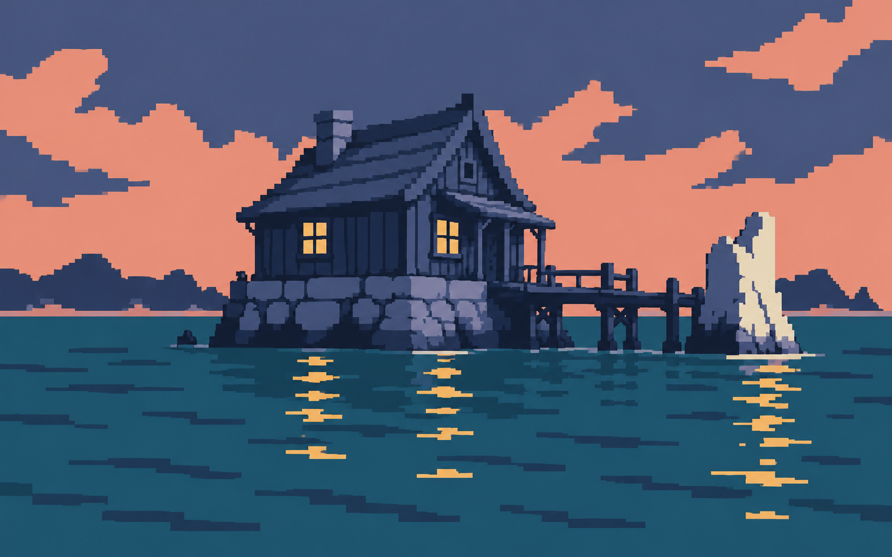
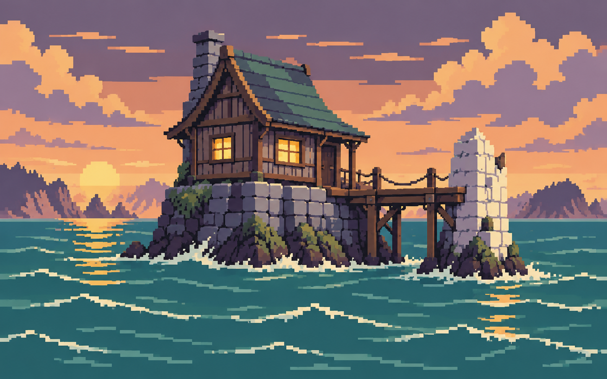
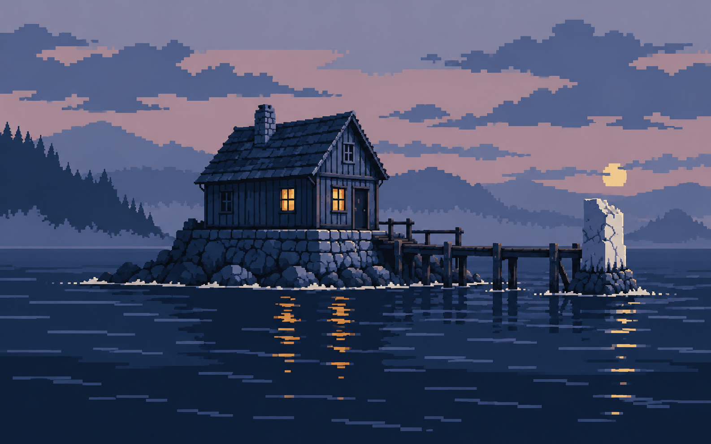

# 画像素材の画風決定と比較案

決定日：2026年10月19日（日本時間）。

**採用はA「くっきりした色面・少色ドット絵」。** ユーザーの指定「もうちょっと雰囲気出して。ドット絵的な感じで」「もうちょい色数へらして」を経て、色数を抑えた最後の比較案から「Aでいこう。docに記述。B、Cもメモっといて」と決定しました。

本書のA・B・Cは、**減色を求められた後に提示した3枚**です。それ以前の多色の比較案と取り違えないでください。画像ファイルそのものをこのリポジトリへ保存し、会話の表示機能や一時パスに依存せず参照できるようにしています。

## A：採用 — くっきりした色面・少色ドット絵

基準画像：[`art-direction/a-selected.png`](art-direction/a-selected.png)。題材はGB01「潮の下の郵便局」。

大きくまとまった色面と角の立った輪郭で形を読み取らせます。木、石、水面を細かな質感で埋めず、屋根・壁・基礎・遠景を整理し、各面の陰影を少ない段階に抑えます。ドットの階段状の輪郭を残し、拡大時のぼかしを避けます。

この見本では、紺・青灰・青緑を基調に、橙色の空と黄色の窓を組み合わせています。暖色を窓や反射などに絞り、静かな冒険の雰囲気を出します。水面は短い横線の集まり、雲や遠景は大きなシルエットで表現します。

導入済みの85点と、今後追加する画像は、Aの色面・輪郭・陰影の簡潔さを共通基準にします。各作品の舞台に応じて色相は変えられます。全作品を同じ海辺や夕焼けにするという指定ではありません。内容、物の数、所在、時刻、情報開示の順序は各作品の本文を優先します。

制作時の要点は次のとおりです。

- 少ない色を複数の物体で使い回し、似た中間色を増やしすぎない。
- 一つの面は基本色と影を中心に描き、微細な階調や写真のような材質表現を避ける。
- ドットのまとまりを大きく取り、小さな表示でも建物や主題を読める形にする。
- 暖色の灯り、寒色の影、余白で雰囲気を出す。細かな描き込みだけで雰囲気を作ろうとしない。
- 縦横比を維持する。整数倍率の拡大が可能な場合は最近傍補間を使い、縦横別の倍率で引き伸ばさない。
- 題名・UI・読ませる文字を焼き込まない。絵だけに必要な手掛かりを置かない。

生成時には8色のパレットを目安として指示しましたが、保存画像は厳密な8色インデックス画像ではありません。**採用されたのは見本Aの見た目で、厳密な色数や論理解像度の固定は未指定**です。後から機械的に8色へ変換したものを、同じ承認済み画像として扱わないでください。

生成指示に使用した基準色：`#172038`、`#384569`、`#747B9A`、`#BB8798`、`#EAA08A`、`#F1C477`、`#24566B`、`#E5D9BD`。これらは生成指示の色であり、保存画像の全画素色を列挙したものではありません。

## B：比較案として保存 — 温かな絵本風

基準画像：[`art-direction/b-reference.png`](art-direction/b-reference.png)。**比較用に保存。現在の共通画風としては採用しません。**

桃色・クリーム・木の茶色・青緑を組み合わせた温かな方向です。建物や屋根の形に柔らかなデフォルメがあり、暖かな窓、苔や波の表現で生活感と絵本らしい不思議さを出しています。Aより物体ごとの色の違いと装飾が多く、穏やかで親しみやすい印象です。

生成指示に使用した基準色：`#292638`、`#56506A`、`#93879A`、`#EDB889`、`#F5D49A`、`#765344`、`#697965`、`#336467`、`#71928A`、`#E8DCC0`。10色を目安とした指示であり、保存画像の実色数ではありません。

## C：比較案として保存 — 寒色中心の幻想感

基準画像：[`art-direction/c-reference.png`](art-direction/c-reference.png)。**比較用に保存。現在の共通画風としては採用しません。**

紺・青・灰紫を中心に、窓と水面の小さな暖色を効かせる方向です。遠景を重なるシルエットで表し、広い空と静かな水面に余白を取っています。Aより低い明度と奥行きを重視し、孤独感や静かな幻想性が強い案です。

生成指示に使用した基準色：`#111D35`、`#263C5D`、`#4D6284`、`#8792B0`、`#B59AA9`、`#DE9B59`、`#F2CC8A`、`#D8D6C6`。8色を目安とした指示であり、保存画像の実色数ではありません。

B・Cは比較経緯を残すための資料です。制作担当が作品ごとに独断でA・B・Cを混在させず、以後はAを基準にします。

## 保存状態と残る確認

3枚ともimagegenで生成したPNG原本をそのまま保存しています。寸法はいずれも1586×992pxです。Aは1586×992pxのままWebPへ圧縮し、GB01表紙へ導入済みです。採用原本の縦横比を優先し、1600×1000pxへの引き伸ばしは行っていません。実際の読書画面でも確認しました。ファイル名・寸法・SHA-256・採用状態は[`art-direction/references.json`](art-direction/references.json)にも記録しています。

2026年10月24日現在、共通本棚・短編36作・中編3作に画像85点・BGM40曲、合計125点を導入済みです。全39作に表紙があり、場面挿絵は短編各1点・中編各3点です。制作経緯は[素材の制作履歴](asset-production-log.md)、中編の作品別一覧は[MEDIUM_ASSETS.md](MEDIUM_ASSETS.md)にあります。

画像がドット絵になったことだけを理由に、音楽をチップチューンへ変更しません。BGMは読書向けの従来方針を維持しています。

GB37〜GB40の画像・BGMは未制作です。導入済み素材もBGMの聴感・3周試聴とSafari実機・実機OS別の確認が残っています。配置と追加時の手順は[ASSET_HANDOFF.md](ASSET_HANDOFF.md)、確認済みの範囲は[VALIDATION.md](VALIDATION.md)を参照してください。

## 変更履歴

初回計画の「紙と鉛筆の質感を薄く残した挿絵。抑えた彩度、明暗の大きな形、生活道具の具体性。作品ごとに色調を変える」という画風案は、2026年10月19日のユーザー指定によってAへ更新しました。旧案はこの履歴に残し、今後の画風指定としては使いません。
