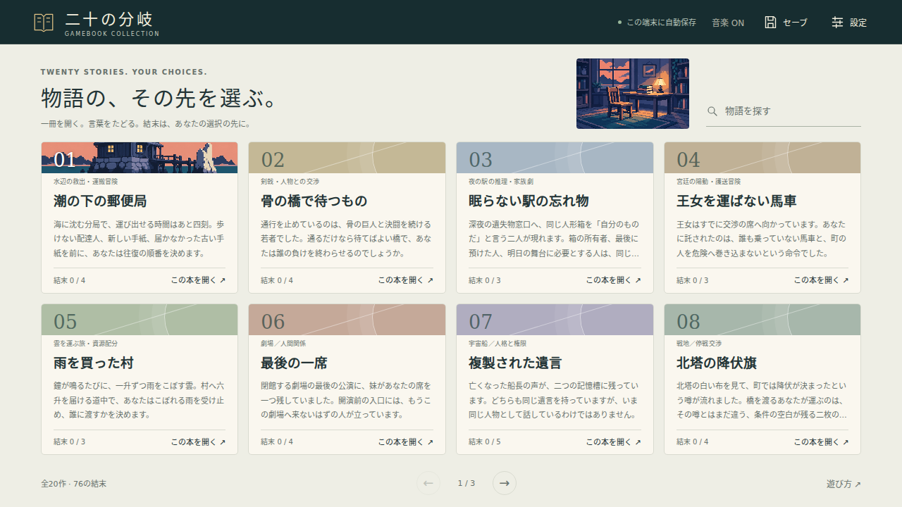
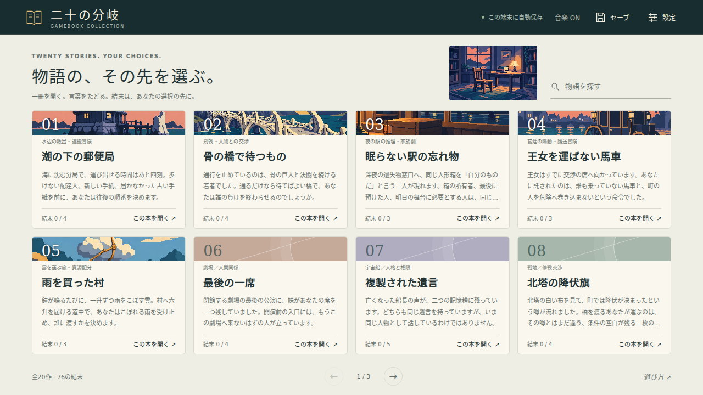
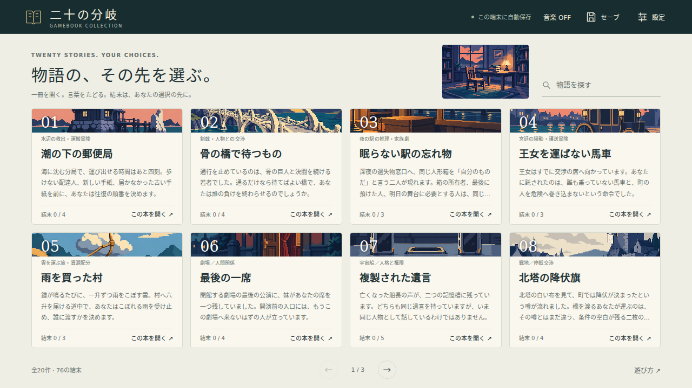
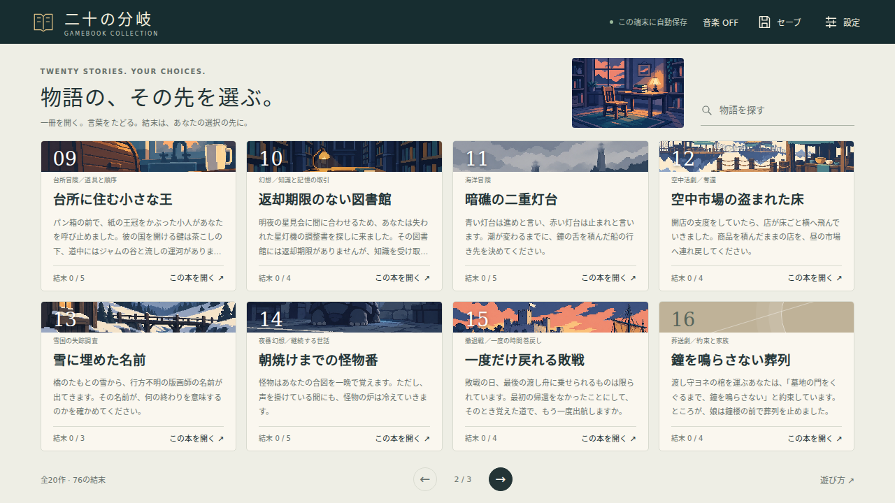

# 素材制作・導入記録

現在：第5回までの42点を導入。全62点中42点（画像21/41点、音楽21/21曲）、P1完了。残りは場面挿絵20点で、次はGB01〜GB05。

2026-10-19・第1回の記録：4点を導入。この時点では残り58点、次の制作予定はGB02〜GB05でした。以下に第1回の記録を保持し、後半へ第2回の8点、第3回・第4回・第5回の各10点を追記しています。

[スマホでのGB01表示](previews/batch-01-mobile.png)。

## 画像の共通処理

採用したAの大きな色面・少ない陰影・階段状の輪郭を使用。生成原本をPNGで保管し、ffmpegのlibwebp、品質95で配布用に圧縮しました。第1回の寸法は原本の1586×992pxを維持しています。初回計画の1600×1000pxへ引き伸ばしたり、2560×1600px以上の原本があると扱ったりしません。厳密な8色への変換も行っていません。

表示は縦横比を保ったobject-fit:coverとpixelated。作品カードは帯の形へトリミングします。読書画面は通常176×110px、今回確認した1280×720では136×85px、スマホでは112×70pxまたは96×60px、横長で高さが足りない画面では省略します。

本棚とGB01を1280×720、390×844、360×640、844×390で検査し、日本語フォントを適用したスクリーンショットで構図・本文・選択肢の収まりを確認しました。画像は判断に必要な唯一の手掛かりにはしていません。

## IMG-GB01-COVER — 潮の下の郵便局

ユーザーが選んだAのPNGをそのまま原本として採用。新規に別構図へ描き直していません。窓の灯り、木の建物、欠けた白い塩柱、水面を主題とし、人物・郵袋・返送箱・救助舟を追加していません。GB01のsetupとauthor.entities／presentationを照合し、救出・回収・結界の復旧を達成済みとして描かないことを確認しました。空の色は共通の作品イメージであり、プレイ中の時刻表示ではありません。

生成手段：imagegen。採用の経緯と色指定は[ART_DIRECTION.md](ART_DIRECTION.md)。配置先はGB01の作品カードと全節共通の既定画像です。

- 配布用：`assets/images/gb01-cover.webp`
- PNG原本：`doc/art-direction/a-selected.png`
- 実寸：1586×992px、WebP、不透明
- 容量：113,262 bytes
- 配布用SHA-256：`5950572a751d778a139387f127dcd5f5966e44f44e1ee3800188eba4c4aca985`
- 状態：導入済み、画面確認済み

## IMG-LIBRARY — 作品一覧の読書室

採用Aを画風参照としてimagegenで新規生成。閉じた本、空いた一脚の椅子、ランプ、夕方の読書室。人物や20作の結末は描いていません。窓の外に水辺が見えるため、指示の「海を入れない」には完全一致していませんが、共通の本棚としての役割や各作品の状態には影響しません。絵は変更せず実物どおり記録します。

使用指示の全文：[library-a.prompt.txt](../sources/images/library-a.prompt.txt)。原本は生成出力exec-5ea17824-6a17-45b2-983d-59faed1142b4.pngから無加工で保存。配置先は本棚の共通イメージです。

- 配布用：`assets/images/library.webp`
- PNG原本：`sources/images/library-a.png`
- 実寸：1586×992px、WebP、不透明
- 容量：165,246 bytes
- 配布用SHA-256：`21912d5467cedcd4392df2a1b3d717d8dc5e891147fb782ebd24155b00979a3c`
- 状態：導入済み、画面確認済み

## 音楽の共通処理

音符・和音・編成を本作向けに作成し、[render-music.py](../scripts/render-music.py)で加算合成しました。外部の録音サンプルは使っていません。ピアノ・木管・弦はそれらを想定した合成音色であり、生楽器の録音ではありません。歌・台詞・効果音なし。ドット絵を理由にチップチューンへ変更していません。

24bit WAVを一時生成し、一定ゲインで約−18 LUFSへ調整した後、Vorbis品質4でOgg化しました。実平均ビットレートはGB01が約42kbps、本棚が約64kbpsです。当初の128〜160kbpsは目安で、今回のファイルの実測値ではありません。WAVは一時ファイルとして扱い、音符・音色・処理を再現するソースを保管しています。

第1回の2曲は4/4拍子・24小節、残響を冒頭へ循環させた全長ループ。台帳の音量は0.35、初期OFFです。1個のAudio要素で曲を切り替え、未制作の作品では停止します。タブ非表示とpagehideでも停止し、表示が戻った時にON状態なら再開します。古いplay()の失敗が新しい曲の再生をOFFにしないよう処理しました。

実Oggの復号、音量、ピーク、サンプル数、境界の波形差を検査しました。Chromiumで実ファイルの再生、GB01末尾から冒頭へのループ、ON/OFF、曲切替、連打時の取消、非表示からの復帰を確認しています。**聴感による音色・圧縮品質・3周連続の試聴は未実施です。数値検査とブラウザ再生確認を、試聴済みとは扱いません。**

## BGM-GB01 — 潮を待つ軒下

D長調／B短調。柔らかなピアノ風の旋律に低い弦風の持続音とパッドを重ね、8小節ずつABA′で循環します。潮の揺れと仕事を続ける静けさを狙った曲です。

- 配布用：`assets/audio/gb01-theme.ogg`
- 編集原本：`sources/audio/gb01-theme.score.json` と `scripts/render-music.py`
- 実時間：84.705873秒、68 BPM、24小節
- 形式：Ogg Vorbis、44,100Hz、stereo
- ループ：サンプル0から3,735,529未満まで（全長）
- 実測：-17.97 LUFS-I、True Peak -6.57 dBTP
- 容量：442,610 bytes
- SHA-256：`26679314f1c1a5d60151e836e6aace92c52ffc63a1f604b9e8e083205dde01e4`
- 状態：導入済み、技術検査済み、試聴確認待ち

## BGM-LIBRARY — まだ開かない頁

F長調。柔らかな木管風の短い旋律、疎らなピアノ風の分散和音、薄いパッドを重ねます。作品を選ぶ時間の伴奏として、強い決着を避けて循環します。

- 配布用：`assets/audio/library.ogg`
- 編集原本：`sources/audio/library.score.json` と `scripts/render-music.py`
- 実時間：90.000000秒、64 BPM、24小節
- 形式：Ogg Vorbis、44,100Hz、stereo
- ループ：サンプル0から3,969,000未満まで（全長）
- 実測：-17.96 LUFS-I、True Peak -7.46 dBTP
- 容量：719,607 bytes
- SHA-256：`3e0a3e473ec48bfa1e5480870392a124b0ee3f196115beb6021af150df623d6c`
- 状態：導入済み、技術検査済み、試聴確認待ち

## 出所と次回への引継ぎ

画像はimagegenの生成物で、Aを参照して制作しました。音楽はこのリポジトリに収録した音符データと合成処理によるものです。第三者の既存画像・楽曲・音源サンプルは取り込んでいません。生成画像の利用条件は作成時のサービス条件に従います。追加の外部素材クレジットはありません。

B・Cの比較PNGはそのまま保持しています。原稿20作・分岐・保存データ形式は変更していません。素材の実体はassets/manifest.json、制作予定と残件はasset-plan.json、画像の識別情報はsources/images/manifest.json、音源の実測値はsources/audio/render-report.jsonを参照してください。

第1回終了時点の引継ぎは「GB02の本文と作者用根拠を読み、Aの画風でGB02〜GB05の8点を制作する」でした。これは下記の第2回で実施しました。音楽の試聴確認待ちは引き続き残件として扱います。

## 第2回 — GB02〜GB05の8点（2026-10-19）

Aを画風参照に、imagegenで4枚を生成しました。大きな色面とドットの輪郭を共通にし、橋・終夜駅・儀礼馬車・荷雲で主題を変えています。生成PNGは無加工で保管し、WebP品質95へ変換。原寸は1584×993pxまたは1586×992pxで、縦横比を変えずに配布しました。

[スマホでのGB04表示](previews/batch-02-mobile.png)。長い題名はtext-wrap:balanceで折返しを整えています。本棚のGB05は荷雲が帯の中に残るようobject-positionをcenter 30%に設定しました。画像自体の切り貼りや変形は行っていません。

音楽は4曲とも音符・和音から新規に作成しました。外部音源サンプルは使っていません。合成スクリプトへ撥弦、ピチカート風、クラリネット風、短い弦、ブラシ風の音色を追加し、作品ごとに編成・旋律・拍の置き方を変えています。第1回の配布音源は変更していません。

画像の数量・所在・結末の先取りを本文と照合しました。4作品の画像とOggを実際のChromiumで開き、4画面サイズで本文を全ページ連結して元の文章と照合。各音源は初期OFF、再生、末尾から冒頭へのループ、停止まで確認しています。聴感による音色・圧縮品質・3周連続試聴は未実施で、技術検査と区別します。

## IMG-GB02-COVER — 骨の橋で待つもの

骨を編んだ橋と西岸を主題にしました。人物、胸札、父の剣、勝敗、流血、開閉状態を決める鎖を描いていません。試合に勝った結果や通行許可の取得を先取りしない構図です。

- 配布用：`assets/images/gb02-cover.webp`
- PNG原本：`sources/images/gb02-cover-a.png`
- 指示全文：[gb02-cover.prompt.txt](../sources/images/gb02-cover.prompt.txt)
- 生成出力：`exec-98a08335-2016-4795-85bf-9218ca33f975.png`、imagegen、A参照
- 実寸：1584×993px、WebP、不透明
- 容量：231,574 bytes
- SHA-256：`da0baff0a6566e1a2022e086a2bae5618717f751f794f58ded1ec68e3f26faf8`
- 状態：導入済み、画面確認済み

## BGM-GB02 — 骨の欄干

短い木管風の問いと低い弦の応答。通行交渉と試合の両方に使える、決着を急がせない緊張。 調・構成はD minor、A8 B8 A′8 B′8です。楽器名は合成音色の方向を表し、生楽器の録音ではありません。

- 配布用：`assets/audio/gb02-theme.ogg`
- 音符正本：`sources/audio/gb02-theme.score.json`
- 構成元：`sources/audio/compose-batch-02.py`、合成処理：`scripts/render-music.py`
- 実時間：91.428571秒、84 BPM、4/4拍子、32小節
- 形式：Ogg Vorbis品質4、44,100Hz、stereo、実平均約65.1kbps
- ループ：サンプル0から4,032,000未満まで（全長）
- 実測：-17.96 LUFS-I、True Peak -8.18 dBTP
- 容量：743,677 bytes
- SHA-256：`7d4a0705d27f04741b9a17c51b5e205e2817ec080b2a6d0831a906deb44d0b5f`
- 状態：導入済み、技術検査済み、試聴確認待ち

## IMG-GB03-COVER — 眠らない駅の忘れ物

終夜駅の窓口と閉じた木箱、左側の銅色の金具を主題にしました。人形や人物、名札、半券、返還の動作は描いていません。箱は作品の共通モチーフで、各節の現時点の保持者を示す図ではありません。

- 配布用：`assets/images/gb03-cover.webp`
- PNG原本：`sources/images/gb03-cover-a.png`
- 指示全文：[gb03-cover.prompt.txt](../sources/images/gb03-cover.prompt.txt)
- 生成出力：`exec-aa4ae73f-8b52-4b93-9303-cb4ba7efff75.png`、imagegen、A参照
- 実寸：1586×992px、WebP、不透明
- 容量：158,798 bytes
- SHA-256：`d1904177aa5fa02b710892c34e460827967d41b8e50f456dd09ea321de46b02e`
- 状態：導入済み、画面確認済み

## BGM-GB03 — 終夜窓口

間を空けたクラリネット風の旋律と小さなピアノ。窓口の夜の生活感を保ち、返還や和解の結果を決めない。 調・構成はB-flat major / G minor、A8 B8 A′8 turn4です。楽器名は合成音色の方向を表し、生楽器の録音ではありません。

- 配布用：`assets/audio/gb03-theme.ogg`
- 音符正本：`sources/audio/gb03-theme.score.json`
- 構成元：`sources/audio/compose-batch-02.py`、合成処理：`scripts/render-music.py`
- 実時間：93.333333秒、72 BPM、4/4拍子、28小節
- 形式：Ogg Vorbis品質4、44,100Hz、stereo、実平均約59.5kbps
- ループ：サンプル0から4,116,000未満まで（全長）
- 実測：-17.96 LUFS-I、True Peak -8.37 dBTP
- 容量：694,022 bytes
- SHA-256：`e4891ced26c9e94ca4f362010aa211d533dc4f40b61d28193fb05bc96b864367`
- 状態：導入済み、技術検査済み、試聴確認待ち

## IMG-GB04-COVER — 王女を運ばない馬車

運河沿いの停止した儀礼馬車と暗い窓を描きました。車内の人影、群衆、監察人、信号旗、会談成立を示す記号を入れていません。王女が車内にいると見せず、車輪も動かしていません。

- 配布用：`assets/images/gb04-cover.webp`
- PNG原本：`sources/images/gb04-cover-a.png`
- 指示全文：[gb04-cover.prompt.txt](../sources/images/gb04-cover.prompt.txt)
- 生成出力：`exec-c587e7ab-115b-4446-a834-b95e2d32e8d6.png`、imagegen、A参照
- 実寸：1584×993px、WebP、不透明
- 容量：186,106 bytes
- SHA-256：`54ab2ac7054c6c404c2f942ffe7737303c58ef3ea38069c5215a475b23ad7e09`
- 状態：導入済み、画面確認済み

## BGM-GB04 — 空席の車輪

軽い撥弦の3+3+2の刻み、控えめな低弦と合成ブラシ。足取りを保ちながら、追跡や会談の成否を音で確定しない。 調・構成はE minor / Dorian color、A8 B8 A′8 B′8です。楽器名は合成音色の方向を表し、生楽器の録音ではありません。

- 配布用：`assets/audio/gb04-theme.ogg`
- 音符正本：`sources/audio/gb04-theme.score.json`
- 構成元：`sources/audio/compose-batch-02.py`、合成処理：`scripts/render-music.py`
- 実時間：87.272721秒、88 BPM、4/4拍子、32小節
- 形式：Ogg Vorbis品質4、44,100Hz、stereo、実平均約71.0kbps
- ループ：サンプル0から3,848,727未満まで（全長）
- 実測：-17.96 LUFS-I、True Peak -4.82 dBTP
- 容量：774,664 bytes
- SHA-256：`88b6046d00ab775cf73b76ce3e22ac77ba12cf38433ec0f76f3d34c72032a06f`
- 状態：導入済み、技術検査済み、試聴確認待ち

## IMG-GB05-COVER — 雨を買った村

乾いた山道の上の小さな荷雲と一本の縄を主題にしました。銀の計量線、瓶、雨滴、鐘、散水済みの苗を描いていません。雲の水量、瓶への移送、贈与、村への配達を画像だけで確定しない構図です。

- 配布用：`assets/images/gb05-cover.webp`
- PNG原本：`sources/images/gb05-cover-a.png`
- 指示全文：[gb05-cover.prompt.txt](../sources/images/gb05-cover.prompt.txt)
- 生成出力：`exec-16074036-8f02-408a-a667-a4e60ebf9190.png`、imagegen、A参照
- 実寸：1584×993px、WebP、不透明
- 容量：111,826 bytes
- SHA-256：`690e4251f09ade79a90293beb6696925117d0044ac3b27248388c11b8f5529f7`
- 状態：導入済み、画面確認済み

## BGM-GB05 — 縄で運ぶ空

撥弦の分散和音に淡い木管と柔らかな低音。乾いた山道を歩く余白。鐘・雨・納品完了を示す効果音は使わない。 調・構成はG major、A8 B8 A′8 turn4です。楽器名は合成音色の方向を表し、生楽器の録音ではありません。

- 配布用：`assets/audio/gb05-theme.ogg`
- 音符正本：`sources/audio/gb05-theme.score.json`
- 構成元：`sources/audio/compose-batch-02.py`、合成処理：`scripts/render-music.py`
- 実時間：86.153855秒、78 BPM、4/4拍子、28小節
- 形式：Ogg Vorbis品質4、44,100Hz、stereo、実平均約61.0kbps
- ループ：サンプル0から3,799,385未満まで（全長）
- 実測：-17.96 LUFS-I、True Peak -7.46 dBTP
- 容量：656,390 bytes
- SHA-256：`a519560f509a526fd31c54b2ba768a6f71a3fb123d5832171cd2e83d7162e33f`
- 状態：導入済み、技術検査済み、試聴確認待ち

## 第2回後の残件

導入済みは画像6点・音楽6曲、計12点。残りは画像35点・音楽15曲、計50点です。次はGB06〜GB10の表紙と音楽10点。P1の基本素材は残り30点、P2の場面挿絵は20点すべて未着手です。B・Cの比較資料は保持しています。

原稿20作の本文・状態・分岐・保存形式は変更していません。BGM6曲の聴感確認は引き続き残件です。

## 第3回 — GB06〜GB10の10点（2026-10-19）

Aを画風参照に、劇場・宇宙船・川町の北塔・小人の台所・図書館の5枚をimagegenで生成しました。原本は1586×992px（GB08のみ1584×993px）。無加工のPNGと指示全文を保存し、原寸・縦横比のままWebP品質95へ変換しました。厳密な8色への減色や引き伸ばしは行っていません。

[本棚の2ページ目](previews/batch-03-library-page2.png)、[スマホでのGB09表示](previews/batch-03-mobile.png)。

カードの帯では主題が見えるよう、GB07をcenter 65%、GB08・GB09をcenter 35%、GB10をcenter 70%に設定。画像自体の寸法や構図は変えていません。

音楽は5曲の旋律・和音・編成を新規に作成。フェルトピアノ風、電気鍵盤風、マリンバ風、倍音風、丸い低音の加算合成音色を加えました。録音サンプルは使っていません。以前の配布画像・音源12点はバイト単位で変更がないことを確認しました。

単体試験54件が成功。ブラウザ全35ケースを実行し、GB10の空のWebPを検出しました。原本から復元して記録済みハッシュと照合し、画像・音楽の10ケースを再実行してすべて成功。他の25ケースも成功しています。新しい5作品すべてで、4画面サイズの表示、本文全ページの連結一致、実Ogg再生、音量0.35、末尾から冒頭へのループ、OFFでの停止を確認しました。全20作のUI経路と保存も検査しています。画像の数量・所在・結末の先取りを本文と照合し、生成原本と画面を目視しました。音楽の聴感による音色・圧縮品質・3周連続試聴は引き続き未実施です。

## IMG-GB06-COVER — 最後の一席

劇場の入口、真鍮の把手、赤い幕、空いた敷居と灯りを主題にしました。招待券、席の割当て、傘の返却や和解の成立を描いていません。建物の最後の公演と劇団そのものの解散を混同しない構図です。

- 配布用：`assets/images/gb06-cover.webp`
- PNG原本：`sources/images/gb06-cover-a.png`
- 指示全文：[gb06-cover.prompt.txt](../sources/images/gb06-cover.prompt.txt)
- 生成出力：`exec-32394ca2-5937-4d75-95d1-8e707e571ac7.png`、imagegen、A参照
- 実寸：1586×992px、WebP、不透明
- 容量：161,530 bytes
- 配布用SHA-256：`ca439ae7f690cf73593ab3d4d710632393a04b1d727dbb6c8a16b79cd2160022`
- 原本SHA-256：`273c2a653a57a2af7eb4ceb703ad26a16cba8ee8139a2b09a44ce38f6fde0c8a`
- 状態：導入済み、画面確認済み

## BGM-GB06 — 暗転前の入口

フェルトピアノ風の短い呼びかけと薄い弦。建物との別れに余韻を残し、劇団の終わりや再会の成立を決めない。 調・構成はE-flat major / C minor、A8 B8 A′8です。楽器名は合成音色の方向を表し、生楽器の録音ではありません。

- 配布用：`assets/audio/gb06-theme.ogg`
- 音符正本：`sources/audio/gb06-theme.score.json`
- 構成元：`sources/audio/compose-batch-03.py`、合成処理：`scripts/render-music.py`
- 実時間：90.000000秒、64 BPM、4/4拍子、24小節
- 形式：Ogg Vorbis品質4、44,100Hz、stereo、実平均約34.6kbps
- ループ：サンプル0から3,969,000未満まで（全長）
- 実測：-17.96 LUFS-I、True Peak -6.66 dBTP
- 容量：388,811 bytes
- SHA-256：`3eb87493e0403a956baf1cbd028ad35439103496fe12656dcbf2484529c5a6c7`
- 状態：導入済み、技術検査済み、試聴確認待ち

## IMG-GB07-COVER — 複製された遺言

別々の記憶槽を二つと、空の接続座を一基だけ描きました。両方に同程度の周囲の反射を置き、通電・休止を示す状態灯や人物の顔を描いていません。現在の接続状態や任用結果を表示する図ではなく、二つの独立した記憶槽と共用設備を示す共通モチーフです。

- 配布用：`assets/images/gb07-cover.webp`
- PNG原本：`sources/images/gb07-cover-a.png`
- 指示全文：[gb07-cover.prompt.txt](../sources/images/gb07-cover.prompt.txt)
- 生成出力：`exec-c2a91228-2cdf-47f6-85da-980aa7877a3d.png`、imagegen、A参照
- 実寸：1586×992px、WebP、不透明
- 容量：83,494 bytes
- 配布用SHA-256：`235ae2e4eb14bb731eed19972c549aeb69b3f1fdc2843fc26e674759437c7469`
- 原本SHA-256：`dc043e5bce034357bc0caba15b99f964c33fd5069c98cd598223d07b0cc98777`
- 状態：導入済み、画面確認済み

## BGM-GB07 — 二つの間

温かな合成パッド、丸い低音、疎らな電気鍵盤。似た音型を異なる休符で一つずつ受け渡し、二人格の同時稼働を示す音声は使わない。 調・構成はA minor / Dorian color、A8 B8 turn6です。楽器名は合成音色の方向を表し、生楽器の録音ではありません。

- 配布用：`assets/audio/gb07-theme.ogg`
- 音符正本：`sources/audio/gb07-theme.score.json`
- 構成元：`sources/audio/compose-batch-03.py`、合成処理：`scripts/render-music.py`
- 実時間：88.000000秒、60 BPM、4/4拍子、22小節
- 形式：Ogg Vorbis品質4、44,100Hz、stereo、実平均約31.0kbps
- ループ：サンプル0から3,880,800未満まで（全長）
- 実測：-17.96 LUFS-I、True Peak -6.05 dBTP
- 容量：341,438 bytes
- SHA-256：`1b5df959c83093b013ec11dd4e72ba3e60e84be1bbd9cfca70031e0cffe543b2`
- 状態：導入済み、技術検査済み、試聴確認待ち

## IMG-GB08-COVER — 北塔の降伏旗

川町の橋、北塔、面談を求める白い布を主題にしました。兵士、避難者、武装解除、降伏成立、捕虜の返還や勝利の祝祭を描かず、本文の交渉と履行を先取りしていません。

- 配布用：`assets/images/gb08-cover.webp`
- PNG原本：`sources/images/gb08-cover-a.png`
- 指示全文：[gb08-cover.prompt.txt](../sources/images/gb08-cover.prompt.txt)
- 生成出力：`exec-cbbbcaf6-a0c9-4ebf-a5a2-a27182c6745c.png`、imagegen、A参照
- 実寸：1584×993px、WebP、不透明
- 容量：160,198 bytes
- 配布用SHA-256：`4bf32838ea4f912d2eb6b54d8e10cd3f390587f33f30910550298effd9dddab2`
- 原本SHA-256：`e64ce2d0f0c396bf68f2a95f54c7138eea5de637d6c2d43aa3fb081c8c28d624`
- 状態：導入済み、画面確認済み

## BGM-GB08 — 机の両側

低い弦と柔らかなピアノに、息の長い木管の問いを置く。行進の拍、勝利の終止、降伏成立の合図を避ける。 調・構成はD Dorian / F major、A8 B8 A′8です。楽器名は合成音色の方向を表し、生楽器の録音ではありません。

- 配布用：`assets/audio/gb08-theme.ogg`
- 音符正本：`sources/audio/gb08-theme.score.json`
- 構成元：`sources/audio/compose-batch-03.py`、合成処理：`scripts/render-music.py`
- 実時間：87.272721秒、66 BPM、4/4拍子、24小節
- 形式：Ogg Vorbis品質4、44,100Hz、stereo、実平均約56.0kbps
- ループ：サンプル0から3,848,727未満まで（全長）
- 実測：-17.96 LUFS-I、True Peak -8.67 dBTP
- 容量：611,422 bytes
- SHA-256：`f41741dc355614f550c5292d07acef0142ff37dabd1b789435ddaed4d678a859`
- 状態：導入済み、技術検査済み、試聴確認待ち

## IMG-GB09-COVER — 台所に住む小さな王

小人の視点の低い台所、閉じたパン箱、乾いた高い足場のカップを描きました。人物、鍵、匙、砂糖糸、洪水を追加せず、道具の保持や時間、王国への帰還を断定していません。

- 配布用：`assets/images/gb09-cover.webp`
- PNG原本：`sources/images/gb09-cover-a.png`
- 指示全文：[gb09-cover.prompt.txt](../sources/images/gb09-cover.prompt.txt)
- 生成出力：`exec-29dfb121-86b3-4983-b725-04ed3ad13fbf.png`、imagegen、A参照
- 実寸：1586×992px、WebP、不透明
- 容量：122,836 bytes
- 配布用SHA-256：`fd559cfdc44c90b8cc529750431b7840694516c38249a2b0ebc2ef92e8829a91`
- 原本SHA-256：`215254650a9445043c8904c010f009b7109becfa86ec934627581182453a0190`
- 状態：導入済み、画面確認済み

## BGM-GB09 — パン箱の遠景

小さなマリンバ風の跳躍とピチカート、軽い木管。大きな台所を歩く発見を主題にし、残り時間を急かす強い拍は置かない。 調・構成はC major / Lydian color、A8 B8 A′8 B′8です。楽器名は合成音色の方向を表し、生楽器の録音ではありません。

- 配布用：`assets/audio/gb09-theme.ogg`
- 音符正本：`sources/audio/gb09-theme.score.json`
- 構成元：`sources/audio/compose-batch-03.py`、合成処理：`scripts/render-music.py`
- 実時間：83.478254秒、92 BPM、4/4拍子、32小節
- 形式：Ogg Vorbis品質4、44,100Hz、stereo、実平均約54.9kbps
- ループ：サンプル0から3,681,391未満まで（全長）
- 実測：-17.96 LUFS-I、True Peak -5.86 dBTP
- 容量：572,450 bytes
- SHA-256：`30ea2bb3738ccf2138248eea3f2d290a0bc8d88754f65b1d0a84d7a4ebd47386`
- 状態：導入済み、技術検査済み、試聴確認待ち

## IMG-GB10-COVER — 返却期限のない図書館

高い書架、空の読書机、星が見える遠い窓を主題にしました。机の本は文字のない一般的な閉じた本で、取得した調整書を示しません。失った体験の幻影、父の死、記憶の回復、星灯機の修理完了を描いていません。

- 配布用：`assets/images/gb10-cover.webp`
- PNG原本：`sources/images/gb10-cover-a.png`
- 指示全文：[gb10-cover.prompt.txt](../sources/images/gb10-cover.prompt.txt)
- 生成出力：`exec-080d5622-ddcf-4b48-9171-ea02b606d529.png`、imagegen、A参照
- 実寸：1586×992px、WebP、不透明
- 容量：130,938 bytes
- 配布用SHA-256：`89f6f433cfa1007c43897085516bc38994a163bb75b3a2e315be17790e66de1f`
- 原本SHA-256：`ef5d7f435e3c64fa30fccd948ea50e5ff2e57135c711d684c640bf7afc14a734`
- 状態：導入済み、画面確認済み

## BGM-GB10 — 頁の外の星

静かなピアノ、薄い持続弦、遠い倍音風の響き。長い休符を残し、記憶の交換や修理の正解を音で選ばない。 調・構成はF major / D minor、A8 B6 A′8です。楽器名は合成音色の方向を表し、生楽器の録音ではありません。

- 配布用：`assets/audio/gb10-theme.ogg`
- 音符正本：`sources/audio/gb10-theme.score.json`
- 構成元：`sources/audio/compose-batch-03.py`、合成処理：`scripts/render-music.py`
- 実時間：91.034490秒、58 BPM、4/4拍子、22小節
- 形式：Ogg Vorbis品質4、44,100Hz、stereo、実平均約42.1kbps
- ループ：サンプル0から4,014,621未満まで（全長）
- 実測：-17.97 LUFS-I、True Peak -3.38 dBTP
- 容量：479,452 bytes
- SHA-256：`8c4dccb954973a91858aa21254f883ae0dfb4ac856369e23ce975a491fc41706`
- 状態：導入済み、技術検査済み、試聴確認待ち

## 第3回終了時点の次回作業

導入済み22点、未制作40点。P1の残りはGB11〜GB20の表紙10点・BGM10曲、P2は全20作の場面挿絵です。次はGB11〜GB15の10点を制作します。Aを共通基準としてB・Cの比較資料を保持し、本文と作者用根拠を照合してから実物を作り、登録・表示・再生検査と記録まで行います。

## 第4回 — GB11〜GB15の10点（2026-10-19）

Aを画風参照に、二重灯台・空中市場・雪の工房・炉獣・河港の5枚をimagegenで生成しました。原本はすべて1586×992px。PNG原本と指示全文を保存し、原寸・縦横比を保ってWebP品質95へ変換しました。厳密な8色への減色や人工的な拡大は行っていません。配布ファイルの容量とSHA-256を確認してから台帳に登録しました。

[スマホでのGB14表示](previews/batch-04-mobile.png)。カードの帯の表示位置は各作品のruntime台帳とasset-plan.jsonに記録しています。読書画面では縦横比を保ち、狭い画面で本文と選択肢の収まりを優先します。

音楽は5曲の旋律・和音・編成を新規に作成。低い木琴風と控えめな手拍子風の合成音色を追加しました。録音サンプル、語り、警笛、鐘、秒針、炉獣への三拍の合図は使っていません。第1〜3回の配布画像・音源22点はバイト単位で同一です。

GB12・GB13で配布Oggの末尾欠落を検出したため、音源を一時ディレクトリで最後まで生成・検証し、書込みと同期を済ませて最後に置換する処理へ修正しました。2曲を再生成し、実ファイルの長さ・容量・ハッシュを再確認。全曲のブラウザ検査にも、小節数・BPMから算出した全長と実デコーダのdurationを照合する回帰検査を加えました。

その後、単体試験54件、ブラウザ全40ケースが成功。新しい5作品すべてで、4画面サイズの表示、本文全ページの連結一致、実Ogg再生、音量0.35、末尾から冒頭へのループ、OFFでの停止を確認しました。全20作のUI進行と保存も検査。画像は本文と数量・所在・結末の先取りを照合しました。音色・圧縮品質・3周連続の聴感による試聴は引き続き未実施です。

## IMG-GB11-COVER — 暗礁の二重灯台

高さの違う二塔、暗礁、海、手前の本船の舷側を描きました。灯室は遠景の霧に隠れ、青赤の信号色や航路の安全を読み取れない構図です。喫水札、標識修復、測深結果、救援や鐘舌の納品を描いていません。

- 配布用：`assets/images/gb11-cover.webp`
- PNG原本：`sources/images/gb11-cover-a.png`
- 指示全文：[gb11-cover.prompt.txt](../sources/images/gb11-cover.prompt.txt)
- 生成出力：`exec-d5d700c0-46ee-4be1-a0bd-08fe303e7ff8.png`、imagegen、A参照
- 実寸：1586×992px、WebP、不透明
- 容量：116,276 bytes
- 配布用SHA-256：`c363e394d3963c00d6bb14ebaa3a470fa3e30c145aa52ae867c66c396b2dbf77`
- 原本SHA-256：`4c028dccbc1e94244e861b38a94b6e2b8f59fbb11a8768fc16d0176ae2b4a16b`
- 状態：導入済み、画面確認済み

## BGM-GB11 — 二本の塔へ

低弦の長い音と疎らなピアノ、淡い持続音で海の広さを出す。警笛・鐘・波の効果音、航路の正誤を示す合図は置かない。 調・構成はG minor / suspended fifths、A8 B8 A′8 turn2です。楽器名は合成音色の方向を表し、生楽器の録音ではありません。

- 配布用：`assets/audio/gb11-theme.ogg`
- 音符正本：`sources/audio/gb11-theme.score.json`
- 構成元：`sources/audio/compose-batch-04.py`、合成処理：`scripts/render-music.py`
- 実時間：89.142857秒、70 BPM、4/4拍子、26小節
- 形式：Ogg Vorbis品質4、44,100Hz、stereo、実平均約40.1kbps
- ループ：サンプル0から3,931,200未満まで（全長）
- 実測：-17.97 LUFS-I、True Peak -7.01 dBTP
- 容量：446,970 bytes
- SHA-256：`ae219202bf4fb694d9e748a5c6bf4f9aa13136f313bf4fe1f3c2c0467270a171`
- 状態：導入済み、技術検査済み、試聴確認待ち

## IMG-GB12-COVER — 空中市場の盗まれた床

空中市場の共用歩廊、一般の屋根や店先の器、遠い外周網を描きました。器は装飾的な一般商品で、ミノの盗品や返却された商品を特定しません。根釘の抜取、引綱の接続、床の返還、ロロの衣装箱や公演を描いていません。

- 配布用：`assets/images/gb12-cover.webp`
- PNG原本：`sources/images/gb12-cover-a.png`
- 指示全文：[gb12-cover.prompt.txt](../sources/images/gb12-cover.prompt.txt)
- 生成出力：`exec-08221a57-11b3-4b50-b58d-8516421dbb3b.png`、imagegen、A参照
- 実寸：1586×992px、WebP、不透明
- 容量：223,294 bytes
- 配布用SHA-256：`515570c2d71533f10a8f75b4a86c9a2521ab27568c215c4902dc76257881f01a`
- 原本SHA-256：`f4dae4937a5881a01027a32200db7e895b9587d9f412f27121dad5f64bd01323`
- 状態：導入済み、画面確認済み

## BGM-GB12 — 風に浮く店先

歯切れのよい木管と軽い撥弦、控えめな合成手拍子。空中市場の手際とおかしみを出し、床の回収や公演の成立を音で確定しない。 調・構成はD major、A8 B8 A′8 B′8 turn4です。楽器名は合成音色の方向を表し、生楽器の録音ではありません。

- 配布用：`assets/audio/gb12-theme.ogg`
- 音符正本：`sources/audio/gb12-theme.score.json`
- 構成元：`sources/audio/compose-batch-04.py`、合成処理：`scripts/render-music.py`
- 実時間：90.000000秒、96 BPM、4/4拍子、36小節
- 形式：Ogg Vorbis品質4、44,100Hz、stereo、実平均約65.1kbps
- ループ：サンプル0から3,969,000未満まで（全長）
- 実測：-17.97 LUFS-I、True Peak -5.36 dBTP
- 容量：731,888 bytes
- SHA-256：`a15339c5ee9a1017a9b27cdd65891021b588030e1146e5ba402e47fef122dcce`
- 状態：導入済み、技術検査済み、試聴確認待ち

## IMG-GB13-COVER — 雪に埋めた名前

雪谷の橋と工房の木肌、暖かな窓を描きました。人影、名前札、足跡、墓標、遺体、転落、救出、帰宅や兄との面会を加えていません。本文で得ていない手掛かりや本人の意思を表紙で確定しない構図です。

- 配布用：`assets/images/gb13-cover.webp`
- PNG原本：`sources/images/gb13-cover-a.png`
- 指示全文：[gb13-cover.prompt.txt](../sources/images/gb13-cover.prompt.txt)
- 生成出力：`exec-d75fa7e6-09ad-4b46-840b-25858a8837c3.png`、imagegen、A参照
- 実寸：1586×992px、WebP、不透明
- 容量：161,886 bytes
- 配布用SHA-256：`8a3366d77e330a19be8d19d5e0a1f2567b42e245479dd513e3923c8e992144ad`
- 原本SHA-256：`b3e9751ff034179d335d824c3c35a512ed5b32ec736229176d082a26b8014d34`
- 状態：導入済み、画面確認済み

## BGM-GB13 — 姓をなぞる雪

低めの木管風旋律、少ないピアノ、短く乾いた弦。雪谷の静けさと本人の意思に余白を残し、死亡や帰宅を決める響きにしない。 調・構成はA-flat major / F minor、A8 B8 A′8です。楽器名は合成音色の方向を表し、生楽器の録音ではありません。

- 配布用：`assets/audio/gb13-theme.ogg`
- 音符正本：`sources/audio/gb13-theme.score.json`
- 構成元：`sources/audio/compose-batch-04.py`、合成処理：`scripts/render-music.py`
- 実時間：92.903220秒、62 BPM、4/4拍子、24小節
- 形式：Ogg Vorbis品質4、44,100Hz、stereo、実平均約61.2kbps
- ループ：サンプル0から4,097,032未満まで（全長）
- 実測：-17.96 LUFS-I、True Peak -9.51 dBTP
- 容量：710,961 bytes
- SHA-256：`52ffae8ce657561a57c07c1a0eb3816e62b1bb0114a2a4258abcf854dfaab45f`
- 状態：導入済み、技術検査済み、試聴確認待ち

## IMG-GB14-COVER — 朝焼けまでの怪物番

荷車ほどの丸い背を持つ炉獣一体を背後から描きました。腹窓と炉光、石炭、熱量、学習回数は見せていません。床の白線は開いた線で、檻や囲いではありません。三拍の動き、展殻、負傷や搬送完了を固定していません。

- 配布用：`assets/images/gb14-cover.webp`
- PNG原本：`sources/images/gb14-cover-a.png`
- 指示全文：[gb14-cover.prompt.txt](../sources/images/gb14-cover.prompt.txt)
- 生成出力：`exec-bbc21269-ebe3-416d-b68b-e30bdcd54787.png`、imagegen、A参照
- 実寸：1586×992px、WebP、不透明
- 容量：124,524 bytes
- 配布用SHA-256：`6264e0a1e890222c6e74ec9963f8ff8ede78a6d2aade3d7c261a9c70c46259f3`
- 原本SHA-256：`b131bfefcf16fbcf05dc5c45e1178eb55a9df45f5f6b10363301d3146d1b659c`
- 状態：導入済み、画面確認済み

## BGM-GB14 — 足音の往復

低い木琴風の単音と柔らかな弦、ゆっくり膨らむパッド。物語の三拍の合図を再現せず、炉色・石炭・学習回数を示す効果音を置かない。 調・構成はB-flat Dorian、A8 B8 A′8です。楽器名は合成音色の方向を表し、生楽器の録音ではありません。

- 配布用：`assets/audio/gb14-theme.ogg`
- 音符正本：`sources/audio/gb14-theme.score.json`
- 構成元：`sources/audio/compose-batch-04.py`、合成処理：`scripts/render-music.py`
- 実時間：90.000000秒、64 BPM、4/4拍子、24小節
- 形式：Ogg Vorbis品質4、44,100Hz、stereo、実平均約32.7kbps
- ループ：サンプル0から3,969,000未満まで（全長）
- 実測：-17.97 LUFS-I、True Peak -5.74 dBTP
- 容量：367,371 bytes
- SHA-256：`c60d65d2a1b90e30aba16d0aa6370938381ab256983032df11b31b40c48b4fcf`
- 状態：導入済み、技術検査済み、試聴確認待ち

## IMG-GB15-COVER — 一度だけ戻れる敗戦

降伏済みの城の白旗、渡し舟の舳先、避難船を共通モチーフにしました。人員や箱を数えられる描写、運搬済みの組、返時針、巻戻し前後の残像を描いていません。同じ人や舟を複製せず、救出結果を表紙で確定しない構図です。

- 配布用：`assets/images/gb15-cover.webp`
- PNG原本：`sources/images/gb15-cover-a.png`
- 指示全文：[gb15-cover.prompt.txt](../sources/images/gb15-cover.prompt.txt)
- 生成出力：`exec-673be4e4-0641-429b-9dcd-ddb653bfb32a.png`、imagegen、A参照
- 実寸：1586×992px、WebP、不透明
- 容量：206,872 bytes
- 配布用SHA-256：`7cb10fcba96d0a19a66689062afa74ef5462964b79512f90224abec7ee6fba66`
- 原本SHA-256：`c73b1661d6a24684deb65fd529b5aa2327c03cb967349cfde0df6ae3fef9e728`
- 状態：導入済み、画面確認済み

## BGM-GB15 — 戻る川の記憶

低弦の緩い脈と控えめなピアノ。同じ音型が少し異なる休符で戻り、救出済みの組や巻戻し実行を決めずに循環する。警鐘・秒針・逆再生の効果音は使わない。 調・構成はC minor / Dorian color、A8 B8 A′8 turn4です。楽器名は合成音色の方向を表し、生楽器の録音ではありません。

- 配布用：`assets/audio/gb15-theme.ogg`
- 音符正本：`sources/audio/gb15-theme.score.json`
- 構成元：`sources/audio/compose-batch-04.py`、合成処理：`scripts/render-music.py`
- 実時間：88.421043秒、76 BPM、4/4拍子、28小節
- 形式：Ogg Vorbis品質4、44,100Hz、stereo、実平均約41.2kbps
- ループ：サンプル0から3,899,368未満まで（全長）
- 実測：-17.98 LUFS-I、True Peak -5.66 dBTP
- 容量：455,899 bytes
- SHA-256：`64d912a7e8503daf37283247988c792b5eec7b7e84f05679b43a2e7c6480be2e`
- 状態：導入済み、技術検査済み、試聴確認待ち

## 第4回終了時点の次回作業

導入済み32点、未制作30点。P1の残りはGB16〜GB20の表紙5点・BGM5曲、P2は全20作の場面挿絵です。次はGB16〜GB20の10点を制作します。Aの画風とB・Cの比較資料を保持し、本文と作者用根拠を照合してから実物を作り、台帳・表示・再生検査・制作記録へ反映します。

## 素材第5回：GB16〜GB20の表紙・BGM

制作日：2026-10-20（日本時間）。10点を追加し、P1の42点がそろいました。Aの少色ドット絵を維持し、B・Cの比較資料、過去の制作記録、原稿本文と全分岐は保持しています。画像は組込みのimagegenで生成・修正し、PNG原本と指示全文を保存しました。GB16・GB18の未採用初稿も保存し、実行用台帳には登録していません。

音楽は本作向けの音符・和音・編成から既存の合成処理で生成しました。外部録音サンプルや既存曲は使用していません。画像の利用条件とクレジットの扱いは前掲の共通記録に従います。以下の楽器名は合成音色の方向です。聴感による音色・圧縮品質・3周連続の試聴は未実施です。

## IMG-GB16-COVER — 鐘を鳴らさない葬列

港町の細い道と静止した鐘楼を主題にし、棺・同行者・参列人数・鳴鐘結果を表示しません。初稿の細かな石壁と瓦を整理し、Aを画像参照した修正で大きな色面へそろえました。

- 配布用：`assets/images/gb16-cover.webp`
- PNG原本：`sources/images/gb16-cover-a.png`
- 指示全文：[gb16-cover.prompt.txt](../sources/images/gb16-cover.prompt.txt)
- 生成出力：`exec-216927ab-171e-4331-be40-01a4aac61395.png`、imagegen
- 実寸：1586×992px、WebP、不透明。リサイズ・減色なし。
- 容量：147,880 bytes
- 配布用SHA-256：`6fb3c5fa0576ca6fd5524672b7121b794c0d98af4a50f2701e317d7ecdde1fb0`
- 原本SHA-256：`6ec9830ccaecec6039e4bf23fa4264364c567aea5221ba05c75b5d4207f05985`
- 配置：作品カードと全節の既定画像
- 状態：導入済み、画面確認済み

## BGM-GB16 — 門までの足音

低い弦と息の長い木管、少ない低音のフェルトピアノ。鳴鐘・チャイム・打楽器を使わず、参列人数や約束の履行を音で確定しない。 調・構成はD minor / suspended sixths、A8 B8 return6です。

- 配布用：`assets/audio/gb16-theme.ogg`
- 音符正本：`sources/audio/gb16-theme.score.json`
- 構成元：`sources/audio/compose-batch-05.py`、合成処理：`scripts/render-music.py`
- 実時間：94.285714秒、56 BPM、4/4拍子、22小節
- 形式：Ogg Vorbis品質4、44,100Hz、stereo、実平均約58.4kbps
- ループ：サンプル0から4,158,000未満まで（全長）
- 実測：-17.97 LUFS-I、True Peak -10.22 dBTP
- 容量：688,501 bytes
- SHA-256：`e43efb801915c231d6b77cfa7db6683cefbb218aa64942606c4163b89112e25c`
- 状態：導入済み、技術検査済み、試聴確認待ち

## IMG-GB17-COVER — 砂時計のない牢獄

外装で仕組みを隠した手動レバー、金属の輪、呼び管を描きました。時計、砂時計、数字、三位置の色、扉の開閉や接続は表示せず、操作回数や時間経過を表紙で固定しません。

- 配布用：`assets/images/gb17-cover.webp`
- PNG原本：`sources/images/gb17-cover-a.png`
- 指示全文：[gb17-cover.prompt.txt](../sources/images/gb17-cover.prompt.txt)
- 生成出力：`exec-69a72a93-6e4f-4dd2-b95d-d12ad73cbc16.png`、imagegen
- 実寸：1586×992px、WebP、不透明。リサイズ・減色なし。
- 容量：127,122 bytes
- 配布用SHA-256：`d43d2c1c70cc7f9472607d125c1a2e8f005e9eec9905fe806a0bc9d152eb298d`
- 原本SHA-256：`f7203ded9b2d6ae6def9cd0d53dfb86c94fa80e1a8e2a5726334b9b54f8e2228`
- 配置：作品カードと全節の既定画像
- 状態：導入済み、画面確認済み

## BGM-GB17 — 人が送る一拍

短い乾いた弦と柔らかな電子鍵盤、操作の間を思わせる不均等な休符。時計・警報・カウントダウン・レバーの効果音は置かない。 調・構成はE Dorian、A8 B8 A′8 turn2です。

- 配布用：`assets/audio/gb17-theme.ogg`
- 音符正本：`sources/audio/gb17-theme.score.json`
- 構成元：`sources/audio/compose-batch-05.py`、合成処理：`scripts/render-music.py`
- 実時間：91.764717秒、68 BPM、4/4拍子、26小節
- 形式：Ogg Vorbis品質4、44,100Hz、stereo、実平均約29.8kbps
- ループ：サンプル0から4,046,824未満まで（全長）
- 実測：-17.96 LUFS-I、True Peak -7.87 dBTP
- 容量：341,475 bytes
- SHA-256：`970f8a8286d905e27f342ddcd6537f86d4eaef10d6d1a2ab3944b7a3a55c4af8`
- 状態：導入済み、技術検査済み、試聴確認待ち

## IMG-GB18-COVER — 花嫁ではない竜

竜ラハと作業場の石積みを描きました。初稿の流れる水と水車は通水達成を先取りするため不採用とし、Aを画像参照して水路内部・出口・調整板を隠す視点へ修正しました。遠景の水面は自然の湖で、本水路の開通を示しません。温石の個数・据付・衣装・出演・支払いも断定しません。

- 配布用：`assets/images/gb18-cover.webp`
- PNG原本：`sources/images/gb18-cover-a.png`
- 指示全文：[gb18-cover.prompt.txt](../sources/images/gb18-cover.prompt.txt)
- 生成出力：`exec-0cee7468-3102-481e-9a60-9c0457a44d25.png`、imagegen
- 実寸：1586×992px、WebP、不透明。リサイズ・減色なし。
- 容量：172,094 bytes
- 配布用SHA-256：`b034ba624bc84a7b35dc2c30015401d0dd43cf69e5012c94bf13f36bfb17a7f8`
- 原本SHA-256：`c18b40e07ab0da7c45f34e0cc67b4c5fc9307a4a4d05f9ce89ab2db6205a8016`
- 配置：作品カードと全節の既定画像
- 状態：導入済み、画面確認済み

## BGM-GB18 — 石を運ぶ役

温かな撥弦と木管、丸い低音。共同作業の穏やかな歩調を出し、婚礼行進曲・婚礼チャイム・通水や支払完了の効果音を使わない。 調・構成はG major / E minor、A8 B8 A′8 turn6です。

- 配布用：`assets/audio/gb18-theme.ogg`
- 音符正本：`sources/audio/gb18-theme.score.json`
- 構成元：`sources/audio/compose-batch-05.py`、合成処理：`scripts/render-music.py`
- 実時間：87.804875秒、82 BPM、4/4拍子、30小節
- 形式：Ogg Vorbis品質4、44,100Hz、stereo、実平均約60.0kbps
- ループ：サンプル0から3,872,195未満まで（全長）
- 実測：-17.96 LUFS-I、True Peak -7.94 dBTP
- 容量：658,771 bytes
- SHA-256：`13f3470789a7c3e83fc73c3fa460e96e57772a8f6f8247f562629cae0ef862c0`
- 状態：導入済み、技術検査済み、試聴確認待ち

## IMG-GB19-COVER — 十二人目の帰還者

雪山の宿営所の門、灯り、受付台を主題にしました。人影、足跡、投影、担架、救助結果は表示せず、帰還人数を数えられる構図にしません。台の閉じた帳面は受付用で、オルが現地で持つ帳面や貸与中の地図を戻したものではありません。

- 配布用：`assets/images/gb19-cover.webp`
- PNG原本：`sources/images/gb19-cover-a.png`
- 指示全文：[gb19-cover.prompt.txt](../sources/images/gb19-cover.prompt.txt)
- 生成出力：`exec-df9e0ea5-e3e8-4847-ab56-fac2697625d9.png`、imagegen
- 実寸：1586×992px、WebP、不透明。リサイズ・減色なし。
- 容量：161,678 bytes
- 配布用SHA-256：`5959185182adcac39cc48ce0a32ee191ec4c22fd7a7524cdd9de7289e335a4e9`
- 原本SHA-256：`45e05293504b33541542cb63b60cdc7408b340e13d71ab56bd66dc3d323958cd`
- 配置：作品カードと全節の既定画像
- 状態：導入済み、画面確認済み

## BGM-GB19 — 重さのある声

薄い弦と柔らかなピアノ、短く返す木管。帰還を待つ暖かさと照合の静けさを残し、録音の声・幽霊音・人数を数える合図を使わない。 調・構成はB minor / D major、A8 B8 A′8です。

- 配布用：`assets/audio/gb19-theme.ogg`
- 音符正本：`sources/audio/gb19-theme.score.json`
- 構成元：`sources/audio/compose-batch-05.py`、合成処理：`scripts/render-music.py`
- 実時間：87.272721秒、66 BPM、4/4拍子、24小節
- 形式：Ogg Vorbis品質4、44,100Hz、stereo、実平均約39.4kbps
- ループ：サンプル0から3,848,727未満まで（全長）
- 実測：-17.96 LUFS-I、True Peak -6.93 dBTP
- 容量：429,919 bytes
- SHA-256：`2365ce56d339bd65b0e129d77c85642148485ccc689a7c0ea49bc931e1328886`
- 状態：導入済み、技術検査済み、試聴確認待ち

## IMG-GB20-COVER — 世界を閉じる小さな店

曲がり角店の表戸と曇りガラス越しの窓明かりを描きました。糸巻き・茶碗・奥の接続・店内の人物は見せず、返納や継承、閉店済みの状態を先取りしません。

- 配布用：`assets/images/gb20-cover.webp`
- PNG原本：`sources/images/gb20-cover-a.png`
- 指示全文：[gb20-cover.prompt.txt](../sources/images/gb20-cover.prompt.txt)
- 生成出力：`exec-339e5503-1ba1-4b08-b579-db60ae953b0f.png`、imagegen
- 実寸：1586×992px、WebP、不透明。リサイズ・減色なし。
- 容量：152,012 bytes
- 配布用SHA-256：`dd983bc557ae9093b6898a11de73645c8957cb84b3c097e3477e20ba80ff192d`
- 原本SHA-256：`6213eb1fd4edc7c79a63c73b820f5cf636dfe027f03378446cc69b68364a3328`
- 配置：作品カードと全節の既定画像
- 状態：導入済み、画面確認済み

## BGM-GB20 — 曲がり角の灯り

穏やかなピアノと丸い木管、薄い弦。閉店と継承のどちらにも使える未完の巡り。扉の閉鎖・錠・世界の消滅を表す効果音は置かない。 調・構成はF major / added ninths、A8 B8 A′8 turn2です。

- 配布用：`assets/audio/gb20-theme.ogg`
- 音符正本：`sources/audio/gb20-theme.score.json`
- 構成元：`sources/audio/compose-batch-05.py`、合成処理：`scripts/render-music.py`
- 実時間：89.142857秒、70 BPM、4/4拍子、26小節
- 形式：Ogg Vorbis品質4、44,100Hz、stereo、実平均約46.4kbps
- ループ：サンプル0から3,931,200未満まで（全長）
- 実測：-17.96 LUFS-I、True Peak -5.04 dBTP
- 容量：516,872 bytes
- SHA-256：`3755c122f21f1bad361b8509f21ddf9b3a846d846e1a42dd82105e2eab4af4df`
- 状態：導入済み、技術検査済み、試聴確認待ち

## 第5回終了時点の次回作業

導入済み42点、未制作20点。共通画面と全20作の表紙・BGMは完了しました。次はGB01〜GB05の場面挿絵5点です。人物の外見を定める前に各原稿の指定節・全到達状態・本文変種を読み、負傷、保持物、参加者、決闘や返却の結果を先取りしない構図にします。完成後に節単位の切替と表紙への復帰を実ブラウザで検査し、台帳と引き継ぎを更新してください。

第5回の表示確認：[本棚2ページ目](previews/batch-05-library-page2.png)・[本棚3ページ目](previews/batch-05-library-page3.png)・[スマホの読書画面](previews/batch-05-mobile.png)。全45ケースの実行結果は[ブラウザ記録](validation/batch-05-browser.json)に保存しています。
